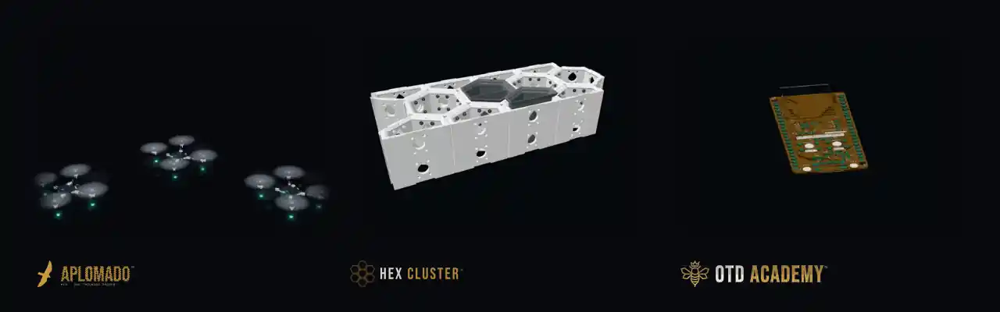
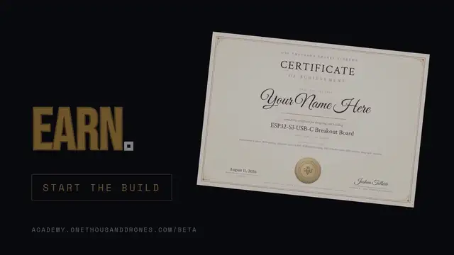

# One Thousand Drones

**One mind, many machines.**

One Thousand Drones builds brain-to-swarm systems: biometrically scaled neuro-robotic shared control that reads an operator's brain and body signals and scales one person's intent across many autonomous machines. Broken Arrow, Oklahoma.

Our open education arm, the Academy, teaches the hardware and brain-computer-interface fundamentals behind that work, one build at a time. It is free and hands-on.

### Aplomado HID

The Aplomado HID section on the company site, simulated signals. Captured October 2026.

A non-invasive EEG brain-computer interface that turns trained motor imagery into supervisory command of a swarm, tested in simulation. The operator's intent becomes high-level directional commands; each machine's own autonomy flies the rest. OIDAT recognizes an operator going down and passes command to a designated successor; it is tested on simulated signals, and the headset is in development.

- **Live demo** · [demo.onethousanddrones.com](https://demo.onethousanddrones.com) · a simulated fleet driven by recorded EEG, in the browser
- **The program** · [onethousanddrones.com/#aplomado](https://onethousanddrones.com/#aplomado) · the headset, the decoder and OIDAT

### Hex Cluster

A v2 build assembling, rendered by the configurator itself.

A bench mounting standard you print yourself. Every base carries a dovetail on all six edges, so a layout of any size locks together and moves as one piece. The geometry is a free download.

- **Files and print spec** · [academy.onethousanddrones.com/hex](https://academy.onethousanddrones.com/hex) · CC BY 4.0, one zip, no account
- **Configurator** · [hex.onethousanddrones.com](https://hex.onethousanddrones.com) · plan a layout in the browser and download only the parts it needs

### Academy

Twenty-two projects from your first ESP32 board to an EEG BCI that commands your own swarm. You draw the schematic, lay out the board, and run the checks. L1.01 is free.

- **Start here** · [academy.onethousanddrones.com/beta](https://academy.onethousanddrones.com/beta) · eight gated cards, a final exam, and a board you drew
- **Reference library** · [academy.onethousanddrones.com/library](https://academy.onethousanddrones.com/library) · 69 lessons, free, no account

### Explore

- **Company** · [onethousanddrones.com](https://onethousanddrones.com)
- **Academy** · [academy.onethousanddrones.com](https://academy.onethousanddrones.com) · open hardware and BCI curriculum, build it for real
- **Brand and media kit** · [onethousanddrones.com/brand](https://onethousanddrones.com/brand)

### Follow

- X · [@1KDrones](https://x.com/1KDrones)
- YouTube · [@1kDrones](https://www.youtube.com/@1kDrones)
- LinkedIn · [One Thousand Drones](https://www.linkedin.com/company/one-thousand-drones)

### Registry

Broken Arrow, OK · USA · SAM.gov registered · CAGE 1ZYS4 · UEI WDQXD9L9UFH3

---

<b>ONE THOUSAND DRONES</b> · [onethousanddrones.com](https://onethousanddrones.com) · [academy.onethousanddrones.com](https://academy.onethousanddrones.com) · [github.com/Otd-llc](https://github.com/Otd-llc)
<!-- otd-readme-kit footer v1 -->
